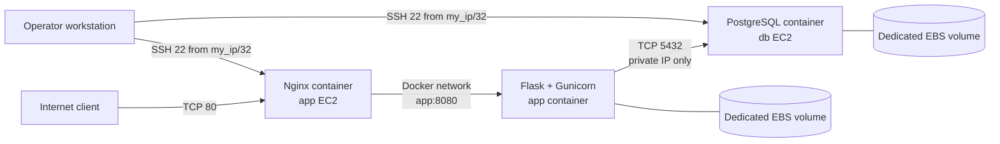

# BARQ Notes API deployment

This repository is a repeatable deployment of a small Flask Notes API on AWS.
Terraform creates the AWS network, security groups, two Ubuntu ARM64 EC2
instances, and one EBS data volume per instance. Ansible installs Docker,
configures PostgreSQL on the database host, builds and runs the application on
the application host, and places Nginx in front of it.

This is a lab-sized, single-region deployment, not a high-availability or
production security design.

## Architecture



Only the application host accepts HTTP. PostgreSQL accepts port 5432 only
from the application security group. SSH is restricted to the public CIDR in
`terraform/terraform.tfvars`. The app image is built on the application EC2
host from the committed [app/Dockerfile](app/Dockerfile), not pulled from a
registry.

## Repository contents

```text
terraform/                 AWS infrastructure and outputs
ansible/                   playbook, group variables, roles, templates
app/                       Flask API, tests, and versioned Dockerfile
compose.yaml               local development stack
scripts/deploy.sh          end-to-end provision, configure, and smoke test
scripts/destroy.sh         reviewed and confirmed Terraform destroy
scripts/generate_inventory.py
docs/team-contract.md      project assumptions and service contract
```

## Prerequisites

Run the deployment from Linux, macOS, or WSL2. The commands below assume a
bash shell and the repository root as the current directory.

Install these tools and make sure they are on `PATH`:

- AWS CLI v2, authenticated to the target account with an IAM user or role
- Terraform >= 1.5
- Ansible >= 2.15 and Python 3
- `ansible-galaxy`, `ansible-vault`, `ssh`, `ssh-keygen`, and `curl`
- Docker and Docker Compose (only required for local development)

The AWS identity must be allowed to create VPC, subnet, route table, security
group, EC2, EBS, and related resources in the selected region. The default
Terraform values target `us-east-1` and the Ubuntu 24.04 ARM64 AMI in
`terraform/variables.tf`; for another region, provide an AMI ID for that
region.

## A. Prepare AWS credentials

Configure the AWS CLI using your organization-approved method, then select
the target profile and region:

```bash
export AWS_PROFILE=my-aws-profile
export AWS_REGION=us-east-1
aws sts get-caller-identity
```

The identity command must succeed and show the account where the lab resources
should be created. If you use the default AWS profile, omit `AWS_PROFILE`.

## B. Create or select an SSH key pair

Create an EC2 key pair in the same region, or reuse an existing one. The
private key is downloaded once and must remain outside Git:

```bash
aws ec2 create-key-pair \
  --key-name barq-notes-key \
  --query KeyMaterial \
  --output text > "$HOME/.ssh/barq-notes-key.pem"
chmod 600 "$HOME/.ssh/barq-notes-key.pem"
export SSH_KEY="$HOME/.ssh/barq-notes-key.pem"
test -f "$SSH_KEY"
```

If the key already exists, set `SSH_KEY` to its matching private key.
`key_name` below is the AWS key-pair name, not the local filename.

## C. Configure Terraform

Find the public IPv4 address of the workstation that will use SSH:

```bash
MY_IP="$(curl -4 -fsS https://checkip.amazonaws.com | tr -d '\r\n')"
printf 'Use this value for my_ip: %s/32\n' "$MY_IP"
cp terraform/terraform.tfvars.example terraform/terraform.tfvars
```

Open `terraform/terraform.tfvars` and replace the placeholders. At minimum it
should contain:

```hcl
aws_region    = "us-east-1"
project_name  = "barq-notes"
instance_type = "t4g.micro"
my_ip         = "203.0.113.10/32"
key_name      = "barq-notes-key"
```

Replace the example IP and key name. Do not commit this file; it is ignored by
Git. `my_ip` must be a CIDR, normally `/32`.

## D. Create encrypted Ansible secrets

Create the encrypted vault file. The deployment script installs the pinned
Ansible collections automatically, so no separate collection installation is
required:

```bash
cp ansible/group_vars/all/vault.yml.example ansible/group_vars/all/vault.yml
$EDITOR ansible/group_vars/all/vault.yml
ansible-vault encrypt ansible/group_vars/all/vault.yml
```

Replace both placeholder values before encrypting with different random
passwords, each at least 16 characters. Keep the Vault
password in a password manager. To avoid an interactive prompt during deploy,
set `ANSIBLE_VAULT_PASSWORD_FILE` to a protected file outside this repository.

## E. Deploy with the deployment script

`scripts/deploy.sh` is the canonical deployment entry point. Do not manually
run Terraform and Ansible commands for a normal deployment; the script already
performs the complete workflow:

1. Checks the required commands, AWS credentials, SSH key, and encrypted Vault
   file.
2. Initializes and validates Terraform.
3. Creates and applies the Terraform plan.
4. Generates `generated/inventory.ini` from Terraform outputs.
5. Waits for SSH and cloud-init on both EC2 instances.
6. Installs the pinned Ansible collections.
7. Runs the Ansible playbook to install Docker and deploy PostgreSQL, the app,
   and Nginx.
8. Runs health and create/read/delete API smoke tests.

Set the SSH key path and run the script from the repository root:

```bash
export SSH_KEY="$HOME/.ssh/barq-notes-key.pem"
bash scripts/deploy.sh
```

The script prompts for the Vault password unless
`ANSIBLE_VAULT_PASSWORD_FILE` is set. It is safe to run again after a
successful deployment; Terraform and Ansible should converge without
unnecessary changes.

The generated inventory is `generated/inventory.ini` and is ignored by Git.
After deployment, verify the result with the API endpoint:

```bash
APP_IP="$(terraform -chdir=terraform output -raw app_public_ip)"
curl "http://${APP_IP}/health"
curl "http://${APP_IP}/notes"
```

### Cross-platform shell scripts

The repository uses `.gitattributes` to enforce Linux LF line endings for shell
scripts and Ansible shell templates. This is required because the scripts run
on Linux hosts and containers; Windows CRLF line endings can make a valid
script fail with a misleading `not found` error.

For a complete rebuild, back up any required data, run `bash scripts/destroy.sh`,
then uncomment the Terraform commands in `scripts/deploy.sh` and run
`bash scripts/deploy.sh` again. Do not delete `terraform/terraform.tfstate`.

For a repeatability check, run `bash scripts/deploy.sh` a second time and
confirm that it completes successfully without unexpected infrastructure or
configuration changes. The script owns the inventory and deployment sequence.

## Backup and restore

Back up PostgreSQL before any destructive operation and keep the backup outside
the repository. The backup uses PostgreSQL custom format:

```bash
mkdir -p backups
DB_IP="$(terraform -chdir=terraform output -raw db_public_ip)"
BACKUP="backups/notes-$(date +%Y%m%d-%H%M%S).dump"
ssh -i "$SSH_KEY" "ubuntu@$DB_IP" \
  'sudo docker exec postgres sh -c '\''PGPASSWORD="$(cat /run/secrets/postgres_app_password)" pg_dump -U notes_app -d notes --format=custom'\'' ' \
  > "$BACKUP"
test -s "$BACKUP"
```

Restore into the existing `notes` database after deployment. This replaces
objects in that database, so verify the backup and target first:

```bash
DB_IP="$(terraform -chdir=terraform output -raw db_public_ip)"
cat "$BACKUP" | ssh -i "$SSH_KEY" "ubuntu@$DB_IP" \
  'sudo docker exec -i postgres sh -c '\''PGPASSWORD="$(cat /run/secrets/postgres_app_password)" pg_restore -U notes_app -d notes --clean --if-exists --no-owner'\'' '
```

Production systems should use encrypted off-host backups, retention, restore
testing, monitoring, and managed database snapshots.

## Cleanup

Save any required backup first. The destroy script requires two explicit
confirmations, creates a destroy plan, displays it, and applies that exact
plan:

```bash
bash scripts/destroy.sh
```

Do not delete Terraform state before destruction succeeds. The AWS key-pair
registration and local private key are not managed by this Terraform code and
are not removed by cleanup.

## Local development

With Docker installed, run the local stack without AWS:

```bash
docker compose up --build
curl http://127.0.0.1:8000/health
docker compose down
```

The local stack publishes only localhost ports and uses development defaults.
See [app/README.md](app/README.md) for API examples and tests.

## Known limitations

- Two EC2 instances and one public subnet are a single point of failure; there
  is no load balancer, autoscaling, multi-AZ layout, TLS, or domain setup.
- The API has no authentication or authorization and should not hold sensitive
  data.
- The application image is built on the target host rather than pulled from a
  registry, so deployments are slower and do not provide registry provenance.
- The AMI ID is region-specific and must be updated when deploying elsewhere.
- Terraform state is local. Use remote encrypted state with locking for shared
  or production use.
- Backups are operator-run commands, not scheduled jobs or managed snapshots.
- The EBS data volumes use `nofail`; backup and restore remain the operator's
  responsibility before `destroy.sh` is run.

## Security and generated files

Never commit AWS credentials, SSH private keys, `.env` files, Terraform state,
Terraform plans, generated inventories, Vault password files, encrypted vault
content, or database backups. The repository `.gitignore` excludes these
artifacts; verify `git status` before committing.
